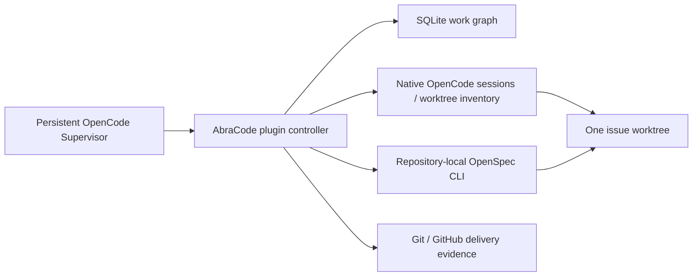

# Architecture

The application layer supplies platform FileSystem/Path/process services and captures them for registered callbacks and monitor fibers in the host plugin scope. Standalone adapter use retains live platform defaults; ordinary reads, directory-name reads and default string writes use injected FileSystem services. Node overloads remain for no-follow file opens, bigint identity, directory entries and specialized write options. Per-command scopes still wait for process-group termination before releasing ownership.

Native-client acquisition is lazy and shared: concurrent initial requests use one acquisition, successful clients are retained, and discovery failure expires immediately for a later retry. It performs no discovery during plugin registration. TUI request slots and the local operation registry use scoped FiberMap ownership; request-version fences, durable stop/generation records and kernel locks remain independent. Closing the application disposes the controller registry before its scoped database closes.

Expected invariants inside Effect generators yield typed domain failures. Pure normalization, record compatibility checks and synchronous SQLite transactions retain explicit synchronous assertions; their adapter boundary maps failures without changing transaction atomicity. `domainEffect` retains a compatibility boundary for synchronous domain helpers, while unrelated programmer defects remain defects. Native tool-policy rejections use the recoverable native tool-error channel.

Workflow evidence projections in `src/workflow/evidence.ts` carry required provisioned, approved, verified and delivered fields into checks, finalization and native worktree operations. They establish schema validity for an observation; generation, operation ownership and exact-content checks still run before committing side effects. Full-spec, lightweight, research and setup policy distinctions remain in the controller.

AbraCode’s SQLite work graph owns issues, priority, repository association, dependency edges and execution claims. Every issue has an explicit `repository_id`. One execution snapshots the workflow and approval/delivery policies before claiming the issue. Request identity and issue creation commit together; claims and guarded transitions run in database transactions.

OpenSpec is the only artifact/task authority. Plans and implementation checklists are real files in the issue branch. AbraCode inspects the configured schema and JSON CLI results; it does not mirror tasks into the work graph.

OpenCode is the only session and worktree authority. The plugin coordinates native APIs and stores relationships/checkpoints in native plugin storage. Registry metadata is not another dependency graph or session store.

## Modules

`src/config` inspects/registers explicit projects and runs authorized setup delivery. `src/git/source.ts` owns managed clones, remote identity/discovery, fetching and inspection; `src/git/workspaces.ts` owns native worktree provisioning and safe retirement shared by issue executions and setup. `src/work` owns the work graph; `src/openspec`, `src/opencode` and `src/git` adapt authoritative systems. `src/workflow/controller.ts` enforces the lifecycle. `src/storage` persists native records and applies OS locks. `src/recovery` handles events and reconciliation; `src/scheduler` filters/prioritizes native ready work. The plugin entrypoint only assembles these modules.

Batch intake reuses `WorkIntake` policy checks and `SqliteWorkGraph` transactions.
`work/batch.ts` owns the bounded keyed definitions and deterministic local-reference
normalization. SQLite schema 5 adds only batch retry receipts and their issue-key
mapping beside existing issue/request/dependency/event tables. The receipt binds
original input; the ordinary graph remains authoritative for current task state.
A complete DAG and all repositories/scopes are checked before writes. Commit
publishes all items together; restart reads the same receipt rather than creating
replacement tasks. Intake grants no admission or checkpoint authority. Existing
native Supervisor tool-success events wake the coalesced reconciliation queue;
periodic reconciliation remains the fallback, with automatic scheduling opt-in.

## State and gates

`workflow/messages.ts` owns follow-up prompt intent beside the existing execution,
using schema-owned bounded identities/payloads in `message-contracts.ts`.
OpenCode owns queue delivery and context. The original assignment capture remains
immutable; the native guard resolves distinct follow-up IDs from trusted retained
state. Kernel operation ownership serializes admission, while short fresh-record
updates preserve concurrent worker reporting without holding coordination across
native callbacks. Uncertain admission holds capacity and forbids replacement
until native evidence or confirmed stop resolves ownership. Pause supersedes
intents, cancels all owned queued IDs before one interrupt, and preserves consumed
history. No message grants plan, scope, merge or delivery authority. See
[steering operations](operations.md#tool-workflow) and
[native evidence](verification/features/steering.md).

| Transition                                    | Required evidence                                                                                                                                      |
| --------------------------------------------- | ------------------------------------------------------------------------------------------------------------------------------------------------------ |
| claiming → provisioning                       | Atomic work graph claim with exact execution actor and in-progress status                                                                              |
| provisioning → exploring                      | Fetched and retained base SHA/target, OpenSpec at that base, native inventory, Git common-dir/origin, issue branch, owned worktree, persistent session |
| exploring → planning → awaiting_plan_approval | Explore outcome succeeded; only planning files changed; complete configured artifacts; strict validation; real task tracking; planning files staged    |
| awaiting_plan_approval → applying             | Current plan fingerprint matches; authorization receipt required by execution policy                                                                   |
| applying → verifying                          | Successful worker outcome, unchanged approved planning contents, all real OpenSpec tasks done                                                          |
| verifying → archiving                         | Checks passed for current content; independent Review passed for the same fingerprint, with full-spec verification evidence when applicable            |
| archiving → delivering                        | Exactly one archived change; canonical specs strictly valid; archived Git tree recorded                                                                |
| delivering → awaiting_merge                   | Intended committed tree, exact branch push, one matching PR (or configured preserved-branch delivery)                                                  |
| awaiting_merge → cleaning                     | Authorized protected merge and verified target ancestry, or exact configured remote branch preservation                                                |
| cleaning → completed                          | Exact owned worktree absent after non-force native retirement; issue closure re-read                                                                   |

Blocked/failed work is reflected in the work graph with guarded ownership updates. Interrupted/recovery-required executions retain their evidence and worktree. A paused worker is stopped without removing its session. An idle/succeeded model is never itself a completion gate.

The public controller exposes lifecycle commands and a read-only query surface. Advancement, authorization, operation ownership and queries own their internal adapters. Setup receives its shared workspace/delivery dependencies directly. Observers and assignment lookup have no controller adapter access.

`WorkerSessions` owns native worker admission, session-location validation, turn observation, retained admission recovery and native stop confirmation. Explicit checkpoints require a successful turn without resubmitting its prompt, and retain the completed role for role-specific evidence checks. Recovery reuses retained session/prompt IDs; an authorized new turn may reuse the session with a fresh prompt. `Advancement` coordinates role selection and policy/approval gates. `ExecutionTransitions` owns phase writes, pause/stop checkpoints, failure reflection and notifications; `Finalization` owns archival, delivery evidence and retirement. A successful native turn still requires matching planning, task, verification and Review evidence.

Pause persists the stop request and advances control generation in the controller, then interrupts its owned operation and obtains exclusive execution ownership. `WorkerSessions` cancels the exact retained native prompt, interrupts recorded sessions and confirms quiescence before releasing worker activity/capacity fields. One controller helper commits the confirmed stop and stopped-operation checkpoint for both foreground pause and restart reconciliation. Native waits run outside shared coordination; uncertain stopping retains the request and reservation.

Short controller-lock sections serialize claims, capacity reservations and validated record commits across processes. Execution-specific kernel locks own slow checks, provisioning, delivery and retirement outside global coordination; reconciliation bounds parallel tickets. Registration/setup have separate resource locks. Never acquire an execution lock, wait for native stop, run Git/checks, or make network calls while holding coordination. Native session/prompt IDs and operation generation, fingerprint and expected postconditions are persisted before submission. Commits reject changed operation identity/input or control generation and preserve newer diagnostic observations.

Active native-turn capacity is separate from retained incomplete execution/worktree capacity. Pending or uncertain admission reserves compute conservatively; confirmed idle/stop releases compute while retaining the issue claim and resources. Approval/CI waits consume retained capacity. Explicit `max_executions` enables multiple retained tickets without increasing model concurrency; omitted limits preserve the old resource ceiling. Every role admission rechecks global, repository and role budgets atomically. Each worker handoff confirms owned sessions are idle.

Native events trigger deterministic reconciliation. A 30-second fallback handles dropped events/crashes. Synthetic Supervisor messages do not trigger new model turns or recursively enter the worker event handler. Worker history remains after resource retirement.

## Enforcement boundary

Explore, Review and Research expose native shell only for agent-browser commands; they have no delegation tools. Explore writes only its change directory through native edit/write or GPT-family patch; Review is read-only. Workers cannot invoke management or approval tools. Session hooks remove non-role tools; execute hooks reject inactive sessions and escaping paths. Supervisor native write/shell tools are excluded. Apply receives shell execution for real development, while delivery and closure remain controller operations.

This is a trusted personal automation system, **not an OS sandbox**. The browser CLI, Apply code and repository checks execute as the service user; arbitrary shell/code can access user files, modify SQLite or invoke Git directly, or forge API requests. Tool filters and native forms do not defend against a hostile same-user process. Protect the target branch with required CI/review, keep provider/server credentials private, and use a separate OS account or restricted environment if adversarial isolation is needed. No container or sandbox framework is introduced in the MVP.

## Deliberate MVP limits

- Linux/single host; one orchestration home and native server. No distributed scheduler, remote workers, custom dashboard or database server.
- `full-openspec` uses repository-local planning and CLI task tracking; task-checkbox approval normalization currently targets `tasks.md`. `lightweight-fix` uses an approved scope with configured checks and independent review. `research-only` retains an immutable scoped report without implementation or delivery.
- GitHub PR delivery supports configured merge, squash and rebase with an exact-head guard. Required-only check policy and no-check delivery require explicit configuration; unavailable required policy stays unconfirmed. Merge queues and required-workflow identities without supported check evidence remain unsupported and waiting.
- A configured `branch` delivery preserves the exact remote commit and can close without merging. Choose it only when that is the desired deliverable.
- Ignored files also prevent cleanup. Build caches/dependencies need preservation or explicit manual removal; the controller never assumes they are disposable.
- PR discovery refuses multiple matches, changed identities or closed-unmerged PRs. Description updates replace only an unambiguous controller-owned summary section. Automatic repair remains disabled pending its explicit bounded policy.
- Server restart recovery begins when the central location is activated. `pnpm start` and `pnpm service:restart` do this without a UI. A separately restarted raw server needs that bootstrap.
- Reconciliation never steals claims or blindly recreates resources with ambiguous ownership. Human repair remains necessary for such states.

## Effect runtime

The server plugin uses `@opencode/plugin/effect`. `applicationLayer` builds the live controller and its injected adapters once per plugin scope. `Layer.build` retains database resources in the host scope after registration completes, so registered callbacks keep a live connection until plugin unload. Backend interfaces return typed `Effect` values, and traced `Effect.fn` operations expose `CrewError` failures. Synchronous domain assertions are converted into that error channel; programming defects remain defects. OpenCode's plugin declarations expose some operations with `unknown` failures, which the native adapter normalizes immediately. The narrowly annotated lint exceptions cover that upstream contract.

The plugin scope owns SQLite connections, scheduler leadership, hook/tool/RPC registrations, monitor fibers and event subscriptions. Monitoring coalesces event bursts through a bounded dropping queue. Each reconciliation tick advances independent executions concurrently under individual ownership, with periodic reconciliation and event reconnection as fallbacks. Closing the scope interrupts work before releasing leadership. Kernel `flock` remains necessary across processes; Effect scopes do not replace it. The lock holder runs with `flock --no-fork` so interrupting it also releases the actual holder.

Subprocess interruption terminates the command’s private process group and waits for the child to close, escalating to SIGKILL for surviving descendants, before releasing writer ownership. Filesystem mutations and record writes finish before interruption releases ownership. Temporary PR files and proposal handles use scoped acquisition and release. Durable intents, native IDs, authorization receipts and delivery evidence still provide restart recovery; fiber interruption does not roll back admitted native work or replace reconciliation. Mutation retries remain guarded by existing identity and evidence checks.

`@opencode/client/effect` supplies HTTP operations and Streams, using the same pinned Effect 4.0.1 runtime as OpenCode 2.0.28. Authentication is captured in a supplied HTTP client. Controller and adapter interfaces retain native ID brands, and the adapter encodes transcript schemas back to wire values for diagnostics, including millisecond timestamps. Effect and host packages stay external to plugin bundles.

The terminal observer owns a separate scope at the native TUI callback seam. Its requests, polling, debounce and navigation use Effects; native Promise callbacks only execute them at that seam. Disposal interrupts its fibers and removes its event listener. Solid rendering and pure domain transformations stay synchronous.

## Domain contracts

`src/identities.ts` defines schema-backed identities for issues, repositories, executions, operations, requests, obligations, reports and other named resources. Commits, Git trees, content hashes and fingerprints remain distinct types. Native sessions, messages, forms, projects, models and paths reuse OpenCode's brands. Text, command arguments and raw I/O remain strings; adapters decode consumed values before passing domain identities into the workflow. Construct generated identities at their owner rather than casting strings or rebranding already typed values downstream. Path brands identify path roles; containment and Git reference validation still run in their owning adapters.

Schemas own record and protocol shapes. Domain types derive from them, with mutable working execution state for transitions and a discriminated `SavedExecution` for decoded phase evidence. Config loading and project reads resolve defaults at their boundaries; `createExecution` captures a complete policy snapshot once at admission. Setup has its own discriminant and permits an empty change name before initialization. Wait kinds determine their reference type, and native question results require an answer only in the answered variant. OpenSpec and forge observation contracts live in pure schema modules shared with storage and the terminal observer.

`Records.update` performs read/validate/change/save under controller coordination. Stale operation commits retain newer observation values and removals. Synchronizing an execution replaces all owned fields, including absence, so a cleared observation cannot survive in a caller's object and reappear on a later save. Unsupported records and invalid record identities stay visible as diagnostics without preventing valid history from rendering.

## Versioned plugin records and backup

Project, setup and execution records use schema version 1. Durable execution variants require phase-specific ownership and preservation evidence. Reads decode records individually and normalize supported legacy data in memory. A coordinated save retains `legacy-original/<original-key>` before the first migration write, preserves additive evidence, and increments the record revision. Unknown versions, mismatched keys and incomplete legacy evidence remain unchanged and visible through `abra_work_list`, readiness, the native work surface and `pnpm doctor` when the service is available. One unavailable record does not hide valid history; new admission and registry changes remain blocked until its ownership is resolved.

Legacy records without a retained verification receipt normalize with an empty verification snapshot: no new commands are guessed from a later project configuration. Preserve their sessions, claims, approvals and worktrees and inspect the missing evidence before an explicit policy revision. A phase name never creates a receipt or authorization. New executions snapshot verification and delivery policy at admission.

Before upgrading real retained work, disable automatic admission, confirm all owned workers and operations have stopped, and export `abra_work_list({include_records:true})`. Save the complete `records` envelope, including unsupported entries and legacy originals, outside disposable worktrees. Keep the native session/worktree inventory and retained report files with that backup. Take a consistent SQLite backup using Node's `node:sqlite` `backup(database, destination)` API while admission is quiescent; do not copy only a live main database file and omit its WAL. Verify the exported identities and restore into a disposable environment before relying on the backup.

Rollback requires writer quiescence. Do not start old code against schema versions it cannot read. A pre-upgrade snapshot is safe to restore only if no later external effects or new work need reconciliation; otherwise retain the upgraded read/recovery path and reconcile forward. Never reset delivery receipts or discard worktrees to make a rollback appear clean.

## Native tool and observer boundaries

Generic tool definitions retain their schemas until native registration. Successful structured output matches JSON content; native Tool.Error carries expected action failures. The strict portable input adapter described in supported-apis.md prevents native input repair from deleting forbidden arguments before validation. Tool progress uses a per-call Context reference with a no-op default for background reconciliation. It reports bounded milestones and counts independently of durable controller evidence.

A Queries observation bundle reads issues and each project/execution/setup collection once per observer request. Readiness, snapshot and detail derive from those values. There is no cross-request authority cache; documents and diffs remain bounded lazy reads. Resource errors affect only the selected resource, while connection errors preserve the last snapshot.

Graph and record committers enqueue invalidations only after durable success. A sliding queue coalesces them in each location's application scope. The publisher crosses a commit-lock barrier, releases it, then emits the home-scoped native event. Publication failure loses an ephemeral hint, never repeats or rolls back a mutation. TUI event subscriptions reconnect and refresh, with five-second polling as missed-event recovery.

The terminal derives running and queued presentation from the synchronized native session/status/pending stores. New and off-screen sessions synchronize without focusing tabs; failed synchronization displays unavailable. Back/Home navigation belongs to a targeted native keymap layer and help uses configured shortcuts. Local button focus traversal remains renderer-owned. UI caches do not authorize controller actions.

New worker admission validates native location-specific inventory outside shared coordination. Retained session/prompt intent, generation fences and capacity reservations remain authoritative. Recovery observes already-admitted prompts before validating a new admission, so inventory drift cannot recreate an existing turn.

## Bounded runtime observations

Owned operation spans and debug logs include issue_id, execution_id, generation and operation_id. These identities are diagnostic fields, never metric labels. `abracode.observer.requests` labels only the five observer methods; `abracode.admission.waits` and `abracode.worker.failures` label only the four roles. Worker-failure increments follow durable commits and compare session, retained prompt and redacted error identity, so repeated saves/observations do not count a new failure. `abracode.reconcile.duration_ms` records reconciliation duration on every exit. No exporter or telemetry dependency is installed.

## Continuous GitHub feedback

`FeedbackService` shares the central monitor and owned issue operation. SQLite still owns work status; observations never close issues. `GitHubReadiness` evaluates current attempts and required/advisory policy for both observation and merge. Discussion reads include submitted reviews, ordinary comments and every published review-thread comment. The adapter checks the PR URL, target and head before and after pagination. Missing pages, mixed identities and oversized substantive content leave an unconfirmed observation.

An execution's optional version-1 `feedback` aggregate holds source identity, a content/attempt revision, original context, current assessed head and handling disposition. Material edits get a different finding ID; prior revisions enter immutable history. Incomplete reads preserve the previous active set. Limits are 256 active findings, 64 findings per diagnostic/correction batch, 8 KiB per finding and 32 KiB total supplemental job detail. History stops at 4,096 retained revisions rather than evicting unresolved evidence. `Records.feedback` exposes read-only pages of 20 findings, historical revisions and action receipts, including after retirement. Legacy records remain unobserved until an authoritative read succeeds.

`AttentionService` keys PR batches by generation, delivered head and semantic revision set. Polling unchanged evidence does not admit another model turn. Diagnosis, code repair, Actions reruns and external runs have independent finite budgets. Feedback is evidence; it cannot approve scope, public communication or merge.

`Records.saveOwned` commits controller aggregate fields under the same revision/operation checks as native progress, preserving concurrent decision and worker observations. `PRActions` owns prepared/running/uncertain/confirmed outbox receipts. Snapshot policy or a concrete bound native form supplies authority. Persisting running admission precedes a GitHub write; uncertain results are reconciled against exact source identity, never resent blindly. Replies carry an authenticated exact-content action marker. Thread resolution is a separate action and never dismisses a submitted review verdict. A fresh feedback/action barrier remains inside guarded merge.

`ExternalValidation` owns the optional no-mistakes protocol. `validating_external` consumes active capacity even without a native worker. A reserved launch nonce, submitted head, accepted intent digest and validation generation identify one external run. External custody prevents native admission, scope invalidation, publication and retirement. Only a supported offered synchronization command can return custody. The controller preserves the resulting commits, then runs native verification and independent Review; external outcomes supply neither native receipts nor merge authorization.

The native server plugin remains the sole lifecycle writer. The existing TUI plugin lazily reads the Feedback resource and uses host navigation, theme and focus handling. Its action buttons queue concrete tool requests in the central Supervisor after an explicit native confirmation. Observer RPCs remain read-only; management tools enforce location, worker and diagnostic permissions.

Post-archive full-spec correction retains the prior native session IDs in its immutable round and admits fresh Explore/Apply/Review sessions for the revised change. This refreshes path-bound native permissions while keeping old sessions identifiable and inactive. External preflight retains the implementation head even when setup is missing, so diagnostics and explicit setup controls have a concrete target without granting branch custody.

## PR action ownership

`PRFeedback` owns the controller's feedback/disposition/action/correction entry points, due polling and known delivery-block recovery. It shares the existing per-issue `Operations`, short coordinated `Records` commits, correction service and native session inventory. `Advancement` orders lifecycle gates; `Finalization` asks the same coordinator for fresh merge clearance. No second issue lock, record store or feedback publisher is introduced.

The pure `actionPlan` model derives obligations from snapshotted policy and exact delivered evidence. Automatic scheduling and all merge routes consume this model, including actions not yet present in the outbox. Per-kind semantic targets eliminate job-level workflow rerun duplication. Read-only adapter preparation creates a bound write request; the action service commits admission before `submit`, while `reconcile` only observes postconditions. Generation/pause checks protect admission and uncertain writes remain observation-only. Controller policy stays outside the GitHub merge adapter, which retains exact repository/PR/head/target validation and guarded merge argv.

Canonical app-aware check/status observations supply both readiness and feedback; optional Actions details enrich an already classified source. External validation owns its own capacity/admission/custody handoff, returning updated state to the lifecycle dispatcher before native verification. Moving these operations does not change native approval, correction, custody, archival or preservation gates.

## Managed role policy

`src/opencode/role-policy.ts` owns the five managed role boundaries. Native session permissions, request tool filtering, execution checks and central profile transforms derive from it. Agent Markdown keeps discovery metadata and behavior guidance; injected frontmatter is not permission enforcement. Foreign worktrees retain their native project configuration and use `build` by default with an assigned role overlay. Native file guards protect control files and planning scope; Shell and CLI execution remain trusted same-user execution, not an OS sandbox. Native command permissions restrict Explore/Review/Research to `agent-browser` and `agent-browser *` under default deny; arbitrary CLI file arguments or shell redirections are not filesystem isolation. Plan/merge approvals and delivery stay in the controller.

Apply may edit repository `AGENTS.md` files within its owned worktree and approved scope. Native file tools continue to reject `.git` and `.opencode` paths; Explore retains planning-only writes and protected instruction files. `worker-assignment.ts` supplies the shared current-session, role/phase, generation and stop checks used by prompt/tool hooks, context observations and worker report endpoints. Checks evaluate fresh retained state at their existing entry and commit points rather than caching authorization across asynchronous work.

Diagnostic eligibility lives beside each tool definition and defaults to denied. Definitions may distinguish input actions: `config` permits status inspection in an attention turn, but not application. The registration wrapper checks central Abra identity and diagnostic authority before invoking the handler. Attention provenance remains controller-owned; diagnostic eligibility never substitutes for endpoint approval, correction or delivery gates.

Browser support reuses native skills, shell permissions and immutable worker context. `abra-browser` is registered centrally and at every foreign worker location. `workerBrowser` derives a browser name and evidence directory from the native session ID; there is no additional resource database or lifecycle controller. Session permissions add only that screenshot directory to existing read roots. Skill inventory availability remains separate from actual loading, and neither grants tools. Supervisor remains management-only.

Browser guidance and browser-only shell tools are optional admission prerequisites unless a worker profile explicitly requires `abra-browser`. Apply still requires a development shell; full-spec workers still require execution guidance. Browser-dependent work reports unavailable browser prerequisites when needed.

### Delivery outcome observations

Approval, deliverable preservation, native retirement and work-graph closure are separate checkpoints. The shared `deliveryOutcome` projection reads their retained evidence and actual issue status without advancing work. Its `observed_at` is the snapshot time; receipt and cleanup observation times remain independent. Tool output and native ticket detail use the same projection. Missing evidence is unavailable or unconfirmed, never an inferred success.

Ordinary post-preservation ignored/untracked residue is retained in optional `cleanup_blocker` evidence while phase stays `cleaning`. The record binds bounded path samples, completeness, observation/reinspection time and stable fingerprint to execution generation and preservation identity. It is diagnostic data, not deletion authority. Older records omit it; invalid additions remain record diagnostics. No new lifecycle state machine or source of authorization is introduced.

The `complete-work-reliably` follow-up builds on the archived `improve-delivery-outcome-reporting` contracts and the integrated specification Review requirements. Its retained `finishing` evidence is additive: records without it have no observed finishing readiness. `finishing-contracts.ts` owns versioned publication bindings, synchronization history, cleanup preflight, exact native disposition targets, directory-policy receipts and routing receipts. Historical generations remain readable; future generations and mismatched target generations are invalid. A publication binding connects the matching verification/Review fingerprint and archived Git tree to the actual published commit; these different identities are not interchangeable.

`finishing-readiness.ts` separates read-only publication/preflight observations from pure next-action selection. It uses the existing execution phase and owned operation rather than a second persisted lifecycle. The caller must establish native writer quiescence, including queued writers, and retain the resulting observations under current ownership. Git owns content/remote observation, Workspaces owns native/resource identity and cleanup safety, and existing verification, forms, publication and retirement owners retain their mutation boundaries. The selector preserves pauses, external custody, current decisions and completed history. Missing observations are unsafe, while unknown provenance, foreign remote drift and unpublished changes after an external merge require decisions.

Preflight shares generated-directory safety inspection with retirement but never stages, journals deletion, removes output or invokes native removal. Authorized paths are excluded by exact literal Git pathspecs only after safety inspection, so nested generated paths cannot hide their siblings. A retained preflight binds generation, operation, worktree identity, publication, content and authorization revision. Comparing its binding also requires a fresh inventory/safety observation; cached readiness is never merge or disposal authority. The controller `Finishing` coordinator owns mandatory routing and synchronization admission. Finalization passes a fresh local guard to the forge adapter, which calls it after its final remote reads and retains the exact-head merge argument. Setup uses the same inspection owner without becoming an implementation execution.

Synchronization consumes a durable execution allowance before staging: two automatic admissions, then one additional exact-input native receipt per attempt. It processes existing attributable work through verification and independent Review; full-spec archival creates a new revision plan while preserving historical archives. It never launches Apply. Failed checks still use the existing corrective policy. The private candidate Git index records the intended tree without changing the real index, allowing staged-input response loss to retain one admission.

Mandatory finishing forms have retained target, session and form identities, bounded routing retries and a visible undelivered state. Their collection does not consume optional diagnostic turns or wait for a diagnostic capacity slot. Explanatory Supervisor prompts remain serialized. Attention reuse requires matching current generation and underlying session, prompt or operation evidence; disproved incidents remain historical with a superseded disposition. A finishing answer cannot approve merge, resume a pause, authorize new coding or change repository defaults.

The shared optional `outcome.finishing` projection supplies consumed/remaining synchronization allowance, current stage, preflight observation and age, and user questions with routing, choices and form identity. It reads committed evidence only. Legacy absence stays unobserved; closure still comes from the work graph. Native views prioritize current decisions over historical exhaustion without deleting incident history.

## Operational supervision

The optional `supervision_mode` composes existing `auto_schedule`, attention and
correction admission. Omission preserves legacy behavior; manual suppresses new
optional reasoning/repair admission, while automatic postures retain captured
finite budgets and all approval/scope gates. Unattended mode retains human-owned
question incidents without explanatory model turns. The existing form collector
recreates native forms under the same retained identity after restart.

The central scheduler owns one small native-store repository rotation cursor
under the existing kernel leader lock. It writes the cursor only after observing
a retained controller execution intent; graph claims, capacity and dependencies
remain authoritative. A lost cursor commit affects fairness order, never ownership.
Native event bursts and fallback ticks feed the existing bounded reconciliation
queue. Budget exhaustion is recorded without reserving a model-attention slot.

`visibility/supervision.ts` derives mutually exclusive presentation classes from
existing phases, obligations, receipts and fresh native observations. It persists
no state and authorizes no actions. Aggregate reads bound native observations to
128 tasks with concurrency four, disclose truncation and retain independent
approval/delivery/cleanup/closure evidence in detail. Failed native observations
remain unavailable. Research report intent, receipt and acceptance join the
existing stale-save protection so concurrent older controller snapshots cannot
erase independently published report evidence.

## Captured model dispatch

`config/dispatch.ts` validates declarative complete selections and resolves one
model per existing worker role. The native runtime still owns model inventory,
selection and execution. Repository declarations and task input share the same
selector shape; tasks cannot select permission-bearing profiles. Task selectors
are retained in the existing SQLite work graph (`dispatch_json`, schema 6), with
original request/batch identities preserved across migration. The existing
execution configuration snapshot captures every resolved model and its source
before provisioning. Record writes reject rewriting that snapshot, and existing
native preflight refuses unavailable models/variants without a fallback. No
second model router, provider client or agent harness is introduced.

Optional project leads are retained management principals, separate from worker
roles. `workflow/leads.ts` validates scope/revision/session under existing kernel
and controller locks; `lead-contracts.ts` owns the bounded retained registration,
proposal and correlation formats. They reuse the request schema/native admission
adapter in `messages.ts`, graph intake, worker-message routing, obligations,
monitor and shared diagnostic/attention limits. OpenCode owns their conversation.
The static hidden profile has no native file, shell or delegation tools. A scope
or model change requires confirmed stop and explicitly rotates native context,
retaining the old ID as revoked. Single-supervisor operation has no lead records
and keeps its existing authority path.

HTML attachments remain an implementation of the existing Reports owner.
`visual-reports.ts` holds its private capture/publication/recovery logic;
`report-snapshot.ts` derives bounded presentation data from controller evidence;
`report-build.ts` runs the installed Vite/Solid toolchain through the existing
ProcessRunner. OpenCode provides preview, not a report compiler. Existing Reports,
Records, coordination/kernel locks, monitor, Mermaid compiler and Solid components
provide the mechanics. Additional state is only the immutable request/snapshot,
source/template/input/output identities, deadline/reservation and result-notice
identity needed to reconcile crash windows. The Markdown receipt remains research
acceptance evidence; HTML is an attachment, and local page state owns no workflow
transition. Structured research input is retained alongside publication intent and
must reproduce the verified Markdown before being used as report data.

Two global kernel slots and retained deadlines bound report compilation across
worker/controller instances. The existing monitor forks bounded recovery so a
compiler cannot serialize scheduler/attention progress. A self-deadlined trusted
CLI has no publication authority: the controller validates and exclusively links
the finished artifact, then commits its receipt under a fresh generation check.
A crash after publication reconciles the original digest. A source revision or
occupied output is a refusal, not permission to mint a replacement identity.
This uses no report backend, watcher, message broker, workflow engine or agent
session manager.
